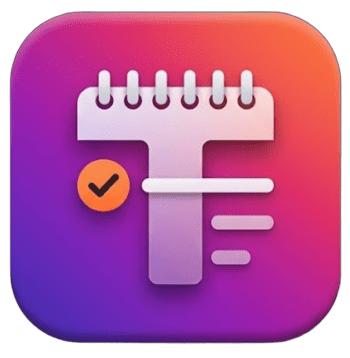

<p align="center">
  
</p>

<h1 align="center">Tudulist</h1>

<p align="center">
  Organização e lembretes de treinos e estudos, de forma <b>prática, funcional e simples</b>.<br>
  App Android nativo, 100% offline, tema sempre escuro.
</p>

---

## Para que serve

O Tudulist facilita **organizar a rotina e não esquecer dela**. Você cadastra uma atividade em poucos toques
(ex.: *Muay Thai, terça e quinta, 6h–7h*), e o app mostra o que vem pela frente e **avisa antes de começar**.
Sem conta, sem internet, sem anúncios, sem tela poluída.

## Funcionalidades

- **Hoje**, **Amanhã** (seção de lembretes do dia seguinte), **Semana** e **Mês** (calendário domingo a sábado,
  com bolinhas coloridas nos dias com atividade).
- **Repetição flexível:** uma vez, todo dia, semanal (você escolhe os dias) ou mensal.
- **Várias atividades no mesmo dia** (treino de manhã, estudo à tarde).
- **Hora de início e de fim.**
- **Alerta configurável por atividade:** nenhum, 15 min, 30 min, 1h ou 1h30 antes do início.
- **Anotações opcionais**, escondidas na lista e visíveis ao tocar na atividade.
- **Aviso de choque de horário:** ao salvar, se duas atividades se sobrepõem, o app mostra o dia, deixa você
  escolher qual alterar **só naquele dia** (ou pular o dia) e mantém as demais semanas como estão.
- **Editar e excluir** qualquer atividade.
- **Categorias** (Treino, Estudo, Outro) com cores diferentes.

## O que foi usado e como

| Tecnologia | Como foi usada |
|---|---|
| **Kotlin** | Linguagem de todo o app. |
| **Android SDK nativo** (`Activity`, `View`) | Interface montada em código, sem bibliotecas de terceiros. O app não tem nenhuma dependência externa. |
| **`java.time`** (`LocalDate`, `LocalTime`, `YearMonth`) | Cálculo das repetições (diária, semanal, mensal), calendário domingo-sábado e comparação de horários. |
| **`SharedPreferences` + JSON** (`org.json`) | Armazenamento local das atividades no próprio aparelho. Nada sai do celular. |
| **`AlarmManager`** (alarmes exatos) | Um único alarme é agendado para o **próximo lembrete**. Quando toca, o app notifica e agenda o seguinte. |
| **`BroadcastReceiver`** | Reagenda os alertas ao ligar o celular, ao atualizar o app e ao mudar a hora ou o fuso. |
| **`NotificationManager` + canal de notificação** | Notificação de alta prioridade antes da atividade. |
| **Vector Drawables + ícone adaptativo** | Ícone do app em vetor, nítido em qualquer tamanho e recorte (círculo, quadrado arredondado). |
| **Gradle (Kotlin DSL)** | Build com Android Gradle Plugin 8.7.3 e Kotlin 2.0.21. `minSdk 26` (Android 8.0+), `targetSdk 34`, `compileSdk 35`. |

### Como funciona por dentro

- Cada atividade guarda a regra de repetição (tipo, dias da semana, data inicial). As ocorrências de um dia são
  **calculadas na hora**, não gravadas uma a uma.
- Mudar ou pular **um dia só** de uma atividade repetida é guardado como **exceção por data**
  (`moved` / `skipped`), sem alterar a série.
- O choque de horário é detectado comparando os intervalos início–fim nos próximos 90 dias.

## Instalação (Android)

> O Tudulist **não está na Play Store**. Por isso o Android trata a instalação como "app desconhecido" e
> faz perguntas. Siga os passos abaixo **sem aceitar tudo no automático**.

### 1. Baixe só daqui
Pegue o arquivo `.apk` **apenas na aba [Releases](https://github.com/Hugoleosilva/Tudulist/releases)** deste
repositório. Não instale um "Tudulist.apk" que chegou por outro caminho (mensagem de terceiros, site
desconhecido), porque você não teria como saber o que tem dentro.

### 2. (Opcional) Confira a integridade
Compare o SHA-256 do arquivo baixado com o que está nas notas da Release:

- **Windows (PowerShell):** `Get-FileHash .\Tudulist-1.0.apk -Algorithm SHA256`
- **Linux/macOS:** `sha256sum Tudulist-1.0.apk`

Se for diferente, **não instale**.

### 3. Libere a instalação só para quem precisa, e por pouco tempo
Ao abrir o `.apk`, o Android avisa que o app que você usou (navegador, Arquivos...) não pode instalar apps
desconhecidos.

1. Toque em **Configurações** na própria mensagem.
2. Ative **"Permitir desta fonte"** **somente para o app que você está usando** (ex.: Chrome ou Arquivos).
   Não existe motivo para liberar para outros.
3. Volte e toque em **Instalar**.
4. **Depois de instalar, desative essa permissão:** Configurações > Apps > *(o app usado)* >
   **Instalar apps desconhecidos** > **Não permitir**.

### 4. Sobre o aviso do Play Protect
O Google Play Protect pode dizer que o app "não é conhecido" ou pedir para verificá-lo. É esperado: o
Tudulist é distribuído fora da loja e é uma compilação de teste (*debug*).

- Prefira **Verificar app**, para o Play Protect analisar antes.
- Só use **Instalar mesmo assim** se você confia na origem (esta página).
- **Não desative o Play Protect** para instalar. Não é necessário.

### 5. Ao abrir, aceite só o necessário
O app pede apenas **notificações** (para os alertas). Para os avisos não serem cortados pelo sistema, deixe
a bateria do app em **Sem restrições** (Configurações > Apps > Tudulist > Bateria).

Se o Android pedir qualquer outra coisa (contatos, localização, fotos, microfone), **negue**: o app não
precisa disso.

## Permissões do app e por quê

| Permissão | Para quê |
|---|---|
| `POST_NOTIFICATIONS` | Mostrar os lembretes. |
| `SCHEDULE_EXACT_ALARM` (Android 12) / `USE_EXACT_ALARM` (Android 13+) | Disparar o aviso na hora certa. |
| `RECEIVE_BOOT_COMPLETED` | Reagendar os alertas depois de reiniciar o celular. |

**O app não pede internet.** Você pode conferir em [`AndroidManifest.xml`](app/src/main/AndroidManifest.xml):
não há permissão `INTERNET`, então ele não consegue enviar dados para lugar nenhum.

## Compilar você mesmo (quem prefere não confiar no APK)

1. Instale o [Android Studio](https://developer.android.com/studio) (gratuito).
2. Clone o repositório e abra a pasta com **File > Open**. Se perguntar o JDK do Gradle, use o **21**.
3. Espere o *Gradle sync* terminar.
4. **Build > Generate App Bundles or APKs > Generate APKs.**
5. O arquivo fica em `app/build/outputs/apk/debug/app-debug.apk`.

## Estrutura

```
app/src/main/
├── java/com/hlls/agenda/
│   ├── MainActivity.kt   # telas (Hoje, Amanhã, Semana, Mês), cadastro, detalhes, choque de horário
│   ├── Task.kt           # modelo, repetição, exceções por dia, JSON
│   ├── Store.kt          # leitura e gravação local
│   └── Scheduler.kt      # alarmes, notificações e reagendamento
├── res/                  # tema escuro, ícone em vetor
└── AndroidManifest.xml
```

## Limitações

- **Só Android** (8.0 ou mais novo). Não há versão para iPhone.
- Os dados ficam **apenas no aparelho**: não há backup nem sincronização, e desinstalar o app apaga tudo.
- A compilação distribuída é de teste (*debug*), não uma versão publicada em loja.
